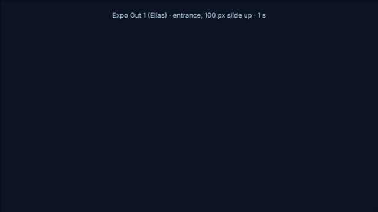
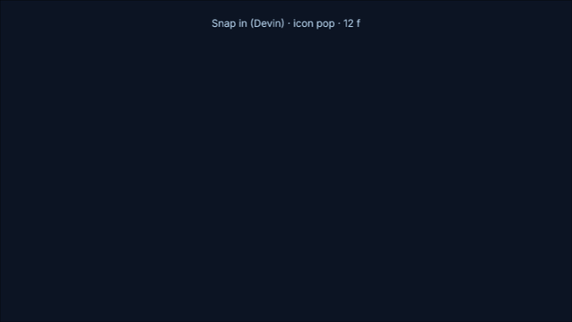
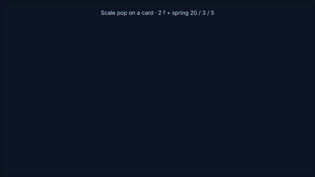

# Elias's taste: every rule with its value, date and why

Newest correction wins. Source files: `~/.agents/skills/video-editing/rules/SYSTEM.md` (the agreed edit system),
the Claude memory folder for EffectCraft, lab R1 (`~/Developer/lab/R1-rsi-intro-exam/REPORT.md`).

## Contents
- [Graphs](#graphs)
- [Expo In-Out](#expo-in-out)
- [Timing on the voice](#timing-on-the-voice)
- [Overlap, holds and exits](#overlap-holds-and-exits)
- [Cards and tiles](#cards-and-tiles)
- [Post and reel cards](#post-and-reel-cards)
- [Pills and tags](#pills-and-tags)
- [Captions and on-screen text](#captions-and-on-screen-text)
- [Colour](#colour)
- [What he rejected](#what-he-rejected)

## Graphs

Motion Library → Devin Jatho → Graphs, 5 cards. The values are normalised After Effects temporal
ease on 2 keys: the move goes 0 → 1 over time 0 → 1, so speed is in units of the average speed
(Δv / Δt). The engine lists the same 5 values: `keys.peakGraphs` (it doesn't know the saved curves below).

| Graph | id (alignPeak) | first key out (speed, influence %) | second key in (speed, influence %) | peak at |
|---|---|---|---|---|
| Fast In | `fast-in` | 23.7527, 0.5927 | 0, 92.9214 | 0.1 % |
| Quick launch · soft landing | `quick-launch` | 0, 39.8783 | 0, 90.9238 | 26 % |
| Smooth emphasis | `smooth-emphasis` | 0, 70.2064 | 0, 70.0732 | 50 % |
| Slow launch · quick finish | `slow-launch` | 0, 83.0011 | 0, 60.1217 | 60 % |
| Fast out | `fast-out` | 0, 100 | 0, 0.8870 | 99.7 % |

### Saved curves (Motion Library `curve_presets`, copied 24 Oct 2026)

Not Graphs-folder cards; same normalised units. ids, beziers and use-cases in `assets/graphs.json`.
Compare and tune all 12 in the "Graphs Lab (Claude)" comp (`scripts/graphs-lab.jsx`, read back with
`scripts/graphs-lab-read.jsx`).

**New taste waits for his OK** ✅ (24 Oct, retro case curves-need-approval): any ease, curve, preset or
style value added from Motion Library or elsewhere is marked ⏳ and builders don't use it until he has
seen it and said OK. Values he already approved are used right away.

⏳ Not approved by Elias yet unless marked ✅ (24 Oct): the Approved column is Motion Library's flag. Don't
use them until he signs them off in the Graphs Lab.

| Curve | first key out (speed, influence %) | second key in (speed, influence %) | Use | ML approved |
|---|---|---|---|---|
| **Expo Out 1 (Elias)** ✅ | 0, 0.1 | 0, 100 | **every off/invisible → visible move, any direction** (retuned by Elias 25 Oct) | yes |
| **Entrance fade (Elias)** ✅ | −0.0073, 34.8183 | −0.0134, 95.5860 | opacity 0→100 of that entrance, ~8 f (the old "expo out graph 1") | – |
| Launch out (Devin) | 0, 100 | 0, 3.35 | on → off at full speed, match cuts | yes |
| Quick out, gentle land (Devin) | 0, 33.33 | 0, 83.6 | soft entrance, slide, text reveal | yes |
| Snap in (Devin) | 0, 11.13 | 0, 100 | punchiest pop / scale in | yes |
| Whip (Devin) | 0, 90 | 0, 90 | whip / slide transition | yes |
| Reel Pop-In (Elias) | 0, 5.6 | 0, 100 | reel/card pops out of a phone | no |

- **Why** (22 Oct): Take 1 had good timing and layout and still "feels off cuz its not using my
  graphs from motion lib". The curves are a core part of what makes it his.
- Only the saved curves listed above from the motion-library MCP's `curve_list` ("fast slide in" ≠ his
  Fast In); not Easy Ease, not the kit's expo-out (0 / 100).
- **Card-row slide-up** (his fix twice: S2 05 card row 19 Oct, Tyson YouTube thumbnails 24 Oct):
  near-instant launch, very long landing. Out 11.5 / in 97.8 (19 Oct) and out 1.1 / in 100 (24 Oct),
  both speed 0; landing key **25–26 f** after launch; 1 f cascade. On 24 Oct he also made the cards
  rise **from fully below the frame** (centre y 1241 → 840, ~400 px), not a 120 px nudge from
  inside it, and added a **black bottom shade** under them: a comp-size black solid, inverted
  mask over the top ~80 %, feather ~180 px, opacity faded in and out with the cards (same 6 f).
  I had used Quick launch 39.9/90.9 over 20 f and 120 px: too soft, too short, too small.

## Expo In-Out

His saved curve for **on screen → another spot on screen** (a stage carry, a footage card
shrinking or changing sides, a dot running along a line). Motion Library `curve_presets`
e7e9542e…, bezier [0.8092, 0, 0.1752, 1], hand-shaped on the Tyson 20-08 Legends stage carry
(21 Oct). Not a Graphs card and not approved in the MCP.

- **Sharper the longer** (22 Oct): about 65 % on both sides for a 1 s move.
  Working formula (a fit, not confirmed by him): `out = clamp(65 + 30 (s − 1), 50, 90)`,
  `in = min(out + 1.5, 90)`: 0.5 s → 50, 1 s → 65, 1.5 s → 80, 2 s+ → 90. Speed 0 both sides.
  `expoInOut(d)` in graphs.jsx does this.
- Its peak sits mid-move, so a move that starts on its word peaks ~10 f later. Whether such moves
  should start earlier is an open question to him (22 Oct).

## Timing on the voice

- Speed peaks land on the **stressed syllable**: the peak sits about 2 frames after the consonant
  burst, i.e. the vowel − 1 frame. Reference: "CON-tent" = frame 1281 in his edit.
- Word and stress timings: `~/.local/bin/scribe-words` (ElevenLabs Scribe) for text; for
  frame-exact stress, `scripts/fork/speech-map` (Scribe → MFA → forward snap, 0.15 f median).
  You transcribe; never ask Elias to.
- Launch key on the stressed syllable's frame: with Fast In the speed peak lands ~1.75 f later.
- His top time sinks, which you must get right first: 1) timing and in/out, 2) size, position and
  overlaps, 3) what gets animated.

## Overlap, holds and exits

- **Overlap** (22 Oct): chained moves (exits → card move → entrances) overlap so the motion never
  fully stops. The next move starts at ~60 % of the previous one, past its peak. Keep the
  word-locked key on its word, shift the other end. An element never exits while its own entrance
  is still running.
- **Hold after landing**, no drift key (19 Oct: a drift key after a 120 px rise overshot on the
  auto-Bezier path, "moving up weirdly"). If a drift is ever wanted, make that key's spatial
  interpolation linear.
- **Exits fade out** over ~8 frames, never a hard cut (19 Oct). Exception: the cut also jumps to a
  clearly different zoom/shot, which hides it.
- Rows: 1-frame cascade left → right. Devin's landings are long: when unsure, a longer tail beats
  a shorter one (he moved a landing key 14 → 20 → 33 f).
- **Entrances from invisible** ✅ Elias 25 Oct: Expo Out 1 (0.1/100) on position, any direction, + Entrance fade on opacity (~8 f).
  
- **Scale pops (0 → full, from invisible)** ✅ Elias tuned 25 Oct (Graphs Lab – in use, 3 s icon + 21 s card):
  the keys are only a **2-frame kick** (0 → 100 %, first key out 0.1 % / speed 0), the Motion Library Bounce
  (`toolkit_bounce` mode overshoot) does the visible motion and sets the landing ease itself. Then:
  - **icon / small UI element:** Bounce 20 %, 3 /s, Settle 5 → peaks ~146 %.
  - **card / pill with text:** Bounce 12 %, 3 /s, Settle 6 → peaks ~135 %, calms faster. 20 % was "too much on a card".
   
  The values live as sliders in Effect Controls ("Scale Bounce %", "Scale Bounces/s", "Scale Settle").
  Run it on his selection via `script.run`, restoring his selection after.

## Cards and tiles

From rebuilding the Surya and Moon Edits reference cards (22 Oct):

- **Body = a 4-Color Gradient**: "that's what he uses in his cards for the background, to have
  those points diagonally: black, and then the rest blue". A near-black point in one corner, blues
  in the others. In EffectCraft: effect `ec.generate.fourcolor` ("4-Color Gradient", points +
  colours + blend). In FigCraft (no 4-point gradient): a base fill + 4 stacked radial gradients
  fitted to the pixels (`~/Developer/lab/R1-rsi-intro-exam/figcraft/refcards/s1_refit.py`,
  ~3/255 mean error).
- **Inner shadows dark**, as dark as the reference measured per zone (the first rebuilds were too
  light on the diamonds and the $ card). A slightly blue body with a darker-blue inner shadow is
  the usual recipe (22 Oct, Moon search bar: "just a blue background … with an inner shadow
  that's slightly bluer or a darker blue").
- **A lighter patch around text or an icon is its glow, not the body.** Measure the body away
  from it and don't copy it as a fill or highlight (22 Oct: "Don't worry about the sort of glow
  that he made on the text. That's what's affecting what's around the text").
- **Rim:** brightness varies around the card. Sample it by angle; an angular-gradient stroke
  reproduces it.
- **Rounded triangles/shapes:** match the reference's corner radius by measuring row widths near
  the corners (he found the first triangle too sharp).
- **Hairline, not stroke:** 1 px on screen, white ~32 % (Devin's). A 3 px solid white stroke reads
  "very, very low quality" (19 Oct).
- The kit's hero gradient (`style.jsx` orb: #8bd2ff → #3a7bff → #1a1f6b) is "too flashy"
  (22 Oct). He is redesigning the look in FigCraft; until that lands, copy the reference.

## Post and reel cards

(19 Oct, S2 05, matched to Devin 6:22)
- Aspect **2:3** (card comp 320 × 480), never 3:4. Screenshot zoomed inside, track-matted.
- Corner radius **8.6 % of the card width**. Hairline as above.
- **Real screenshots only.**

## Pills and tags

His own finish (19 Oct, S2 05 VIRAL tags), the one glow he chose:
- Pill: Gradient Ramp red #FF0000 (top) → #FF2A2A (bottom); Deep Glow (Native): radius 116,
  exposure 0.01, spread 33, downsample 80, unmult on, dither 50, Screen; scale pop with the
  Motion Library Bounce.
- Pill text: the same Deep Glow + Drop Shadow (black, 100 %, 135°, distance ≈1.8, softness ≈2.8).
- Every pill gets Deep Glow + bounce; the ramp and the text stack were on Tag 0 only: build that,
  ask before copying to siblings.

## Captions and on-screen text

- Captions over the talking head: Motion Library preset **Elias/Text styles ▸ Caption glow + double
  shadow** (id 9a0c3382…). He scaled one to 133 %: build them bigger.
- On-screen text = the point, not a transcript: the takeaway or the twist, built as it's said,
  held once the thought is complete, then cleared. Colour only the word that carries the contrast.
- Important lines without a full animation get the spotlight `Text_Mid_video`
  (Devin Jatho → Text): reveal across the whole phrase, hold through pauses, text and dark
  background fade out together, no extras.
- Pattern interrupt about every 10–15 s (text counts, zooms don't).

## Colour

- 10-10 video (22 Oct): P01 Clock blues: navy `#0c1423`, mid `#236197`, bright `#4697f3` (accents),
  ice `#c5e4ff` (secondary text), white (main text). No red/green highlights there. Stroke taste
  for card/media frames in 10-10: 1 px, gradient white → dimmer white.
- Graphic-scene backgrounds: dark navy / near-black gradient (e.g. ramp [0.03, 0.09, 0.2] →
  [0.02, 0.05, 0.12] over #08080B). **Never purple** (18 Oct), never the presenter room photo.
- Client styles: Tapa = Devin style; Adrien = Tapa with blue → orange, nothing else.

## What he rejected

| Rejected | When | Instead |
|---|---|---|
| Keyed / cut-out UI screenshots | 24 Oct | real layers: live text, shapes, ML icons |
| A whole text line appearing at once | 24 Oct | each word pops on its spoken word ([text-animation.md](text-animation.md)) |
| Two words readable at once in a swap | 24 Oct | clipped word window, same ease, one line-height apart |
| 1 f delay per travelling word | 24 Oct | ≈ 0.35 f per word |
| Glows the reference doesn't have | 22 Oct | copy only the reference |
| Kit hero gradients as "the look" | 22 Oct | his FigCraft design / the reference |
| Generic eases (Easy Ease, kit expo, MCP curves) | 22 Oct | his Graphs |
| Thick white card outlines | 19 Oct | 1 px hairline at ~32 % |
| Code-drawn placeholder images | 19 Oct | real images or a flat named placeholder |
| Drift keys after landing | 19 Oct | hold |
| Hard-cut exits | 19 Oct | 8 f fade |
| Purple | 18 Oct | dark navy |
| Learning from his old projects | 18 Oct | only the 8 reference comps and his picks |
