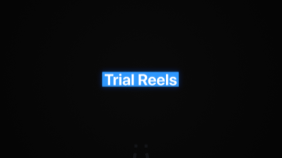
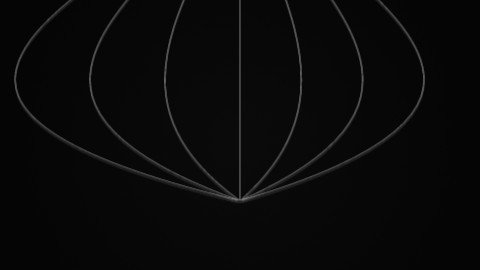
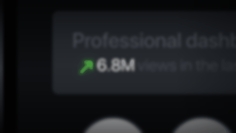
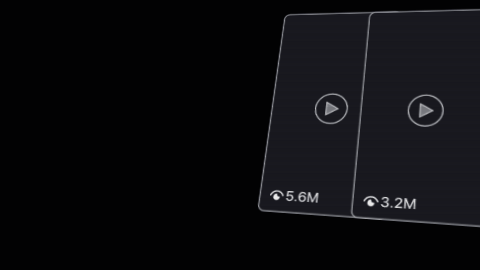
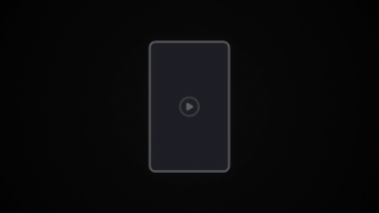
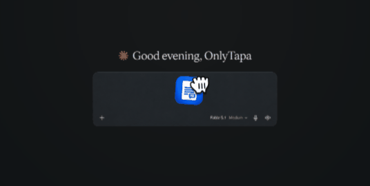

# Motion kit catalog

Generated by `python3 catalog.py` — don't edit by hand. Everything in the kit, with a preview;
what agents propose; what's waiting in the inbox. Answer proposals with one word each:
**yes**, **no**, or **merge with `<primitive>`**.

## Primitives

| Preview | Primitive | What it does | Call |
|---|---|---|---|
|  | **`orb`** [lib/orb.jsx](lib/orb.jsx) | The style's hero shape: radial gradient, inner shadow (bottom-right), 0.7 px white hairline. Circle or rounded square. | `orb(comp, {shape: "circle"\|"rounded", size, x, y})` |
|  | **`background`** [lib/background.jsx](lib/background.jsx) | Full-frame radial grey (#4d4f56 → #121317), sent to the back. Only added when a scene makes its own comp. | `background(comp)` |
|  | **`pop`** [lib/pop.jsx](lib/pop.jsx) | Scale in 0 → 115 → 95 → 100 % by 0.54 s, eased, with a 0.12 s fade. | `pop(layer, {at})` |
|  | **`slideUp`** [lib/slide.jsx](lib/slide.jsx) | Rise 120 px (at 1080p) into place on expo out (out influence 0 / in influence 100) over 1 s, with a 0.12 s fade. | `slideUp(layer, {at, duration, distance})` |
|  | **`stagger`** [lib/stagger.jsx](lib/stagger.jsx) | Many entrances in rhythm: in-order, reverse or center-out, 0.08 s apart, or fitted into a total time. Works on any layers and any entrance. | `stagger(layers, {enter: slideUp, at, total: 1.5, duration: 1.0, order})` |

## Scenes

| Preview | Scene | What it is | Build |
|---|---|---|---|
|  | **hero** [hero.jsx](hero.jsx) | Orb and rounded square, popping in (side by side; stacked in portrait). | `./build.sh hero` |
|  | **row** [row.jsx](row.jsx) | Five orbs rippling in from the centre with pop. | `./build.sh row` |
|  | **row-slide** [row-slide.jsx](row-slide.jsx) | Five orbs rising in left to right with slideUp, all landed by 1.5 s. | `./build.sh row-slide` |

## Proposed (73 waiting for you)

### Templates: a whole comp, reusable with knobs (8)

Each keeps the comp exactly as made; the call lists what you'd change per video.

| Preview | Proposal | What it would capture | Call it would enable | Overlaps | From |
|---|---|---|---|---|---|
|  | **trialRingsFlow** Scrolling flow: title tag + icon, dashed path to a lit progress ring, path on to a post card the cursor clicks | The whole DJ1 comp as a reusable explainer beat: a WORLD null scrolls down a two-branch diagram, one branch lights up and fills to a percentage, the route continues to a post card. Every text, colour, value and stop time is a knob. | `trialRingsFlow(comp, {at, title: "Trial Reels", tagColor: "#2a8efd", icon, activeLabel: "Non-Followers", inactiveLabel: "Followers", value: 100, suffix: "%", views: "693K", button: "Post", side: "left", fillAt: 2.2333, fillDuration: 1.6667, scrollStops: [124.38, -972, -2135]})` | builds on parts dashedConnector, ringStat, countUp, focusBranch, scrollStops, titleTag, postCard, cursorClick, accentGlow, darkStage; no kit primitive covers it | [dj1-trial-rings](references/dj1-trial-rings.recipe.json) |
|  | **trialToggleReelWall** Camera drops onto a setting toggle + tapped button, a ray fan opens, rows of reels stack up as the camera pulls back | The whole DJ2 comp as a reusable 'one tap → reaches lots of people' beat: CAM CTRL drop-in, rigged toggle row and button, expression ray fan, repeater reel wall revealed row by row on the zoom-out steps. Labels, colours, counts and beats are knobs. | `trialToggleReelWall(comp, {at, label: "Trial", on: true, button: "Post", buttonColor: "#566afa", rays: 7, rayColor: "#ededf2", cols: 7, rowsAt: [1.933, 2.733, 3.367], floodAt: 3.833, zoomTo: 43.37, exit: true})` | built from parts rayFan, settingRow, toggleSwitch, touchDot, cardGridStack, cameraDropIn, stepZoomOut, darkStage; no kit primitive covers it | [dj2-trial-toggle](references/dj2-trial-toggle.recipe.json) |
|  | **viewsCounterCard** Dashboard views counter: pull back from a stat card on a phone as the number races up | DJ3 whole: one CAM CTRL null scales the scene 195.8% to 100% while the frame racks into focus (blur 40 to 0 in 0.3 s) and a green trend arrow + counter run 6.8M to 42.8M with a trailing label, over a blurred app screen and phone edge. | `viewsCounterCard(comp, {at, title: "Professional dashboard", label: "views in the last 30 days", from: 6.8, to: 42.8, decimals: 1, suffix: "M", countDuration: 1.9333, color: "#5ceb45", zoomFrom: 195.81, focusBlur: 40})` | uses countUp, trendArrow, statCard, nullPullBack, defocusIn, focusFalloffUI, phoneEdgeCloseup, sideFalloff; nothing in the kit yet | [dj3-views-counter](references/dj3-views-counter.recipe.json) |
|  | **tiltedStatsReveal** Tilted 3D reel cards push in, hard cut to a glowing ring stat counting up | DJ4 whole (2.8 s): two reel cards with view counts tilted in 3D drift toward a 50 mm camera and spread apart; at 1 s a hard cut to a blue progress ring (61.9% to 89.6%) with a 12 fps count to 169K and a '100% Non-followers' legend, the cards echoed as a pixelated mosaic, blue haze and faint scanlines over everything. | `tiltedStatsReveal(comp, {at, cards: ["5.6M", "3.2M"], cutAt: 1, progress: [0.6194, 0.896], countMax: 190, suffix: "K", pct: "100%", label: "Non-followers", color: "#0a8aeb", ring: ["#2dbcff", "#4fd0ff"], titles: ["Normal Reel", "Trial Reel"], tilt: [-21.97, 16.91, 8.69]})` | uses ringStat, countUp, accentGlow, lightSweep, reelCard, tiltedCardPush, mosaicEcho, settleSlide, driftApart, statLegend, hazeGlow, scanlineTexture | [dj4-tilted-stats](references/dj4-tilted-stats.recipe.json) |
|  | **cardVariantsVerdict** Reel card variants: tag, blur-cut to two copies, scan, DUPLICATE stamp on one, labels and a green pass | 14.57 s at 1920×1080. A single card gets a tag (2.47 s), a blur-cut at 4.8 s splits it into two copies, a yellow scan rises over both (5.33–8.2 s), the right one turns red and gets stamped and shaken (7.67 s), then the rig pans left, two icon labels name what changed (9.97 / 11.27 s) and the outline goes green (13.63 s). | `cardVariantsVerdict(comp, {at, tag: "+5% Speed", stamp: "DUPLICATE", labels: [{text: "Flipped", icon: "flip"}, {text: "+5% Speed", icon: "speed"}], failColor: "#ed0f14", passColor: "#3ded45", scanColor: "#fcdb00", card: footage?, times: {cut: 4.8, stamp: 7.667, pan: 9.4, pass: 13.633}})` | uses darkStage, accentGlow, nullPullBack, and the parts below; nothing in the kit yet | [dj5-card-variants](references/dj5-card-variants.recipe.json) |
|  | **dragDropAttach** Files dragged by a hand into a prompt box, landing as captioned attachment chips | 8.6 s at 2142×1080. Per file: a closed hand carries the icon along a curve from off-screen bottom right (1.97 s), the icon shrinks into a chip, the hand opens and fades, and the filename appears 65 px below. Files stagger 2.4667 s apart, landing 175 px apart. Note: the path expressions currently fail in EffectCraft, so the reference GIF shows no travel (see breakdown). | `dragDropAttach(comp, {at, box: footage, files: [{icon, name}], step: 2.4667, spacing: 175, from: [x, y], travel: 1.9667})` | uses darkStage and the parts below; cursorClick (proposals.json) covers the cursor idea | [drag-drop](references/drag-drop.recipe.json) |
|  | **igProfileEarnings** Instagram profile on a phone, earnings card rises over it: “$100–$500 just from that video” | The whole ig1 comp: phone flies in from the right while the profile scrolls to the reel grid (sticky tabs), a light card rises 32 px as the phone blurs to 6, a green ↗ springs in, the amount builds in two hard cuts and the tail words drop in. | `igProfileEarnings(comp, {at, low: "$100", high: "–$500", tail: "just from that video", lowAt: 2.9333, highAt: 3.6667, tailAt: 4.5333, arrowColor: "#73c98f", cardColor: "#f6f7f9", username: "yournamehere", name: "Your Name Here", posts: "883", followers: "14.1K", following: "1 000", bio, highlights: ["About", "Catalog", "Price", "Reviews", "Location"], time: "9:41", scroll: [197.5, 790], stickAfter: 650, blur: 6})` | slideUp (card rise), pop (arrow), phoneMock (proposals.json) | [ig1](references/ig1.recipe.json) |
|  | **youtubeZoomOutLink** Zoom out from your video to the YouTube page; cursor lands on the description link | The whole comp: the full-frame video leaves through the top as the watch page rises and scales 86 → 100 % (2.17 s, long glide), a cursor settles on the first link, then a hard cut back to the video with a 0.2 s blur-to-sharp. | `youtubeZoomOutLink(comp, {at, video, title: "Claude + Instagram = $32,561", channel: "Tapa", subscribers: "17.7K subscribers", avatar, likes: "39", views: "4,334 views  Sep 28, 2026", lines: [cta, link, cta2, link2], target: "link", colors: {description: "#373737", text: "#f2f2f2", link: "#3dadd1"}, moveDuration: 2.17, cutBack: 2.6, returnBlur: 28})` | cursorClick (proposals.json), defocusIn (dj3) | [youtube-zoom-out-link](references/youtube-zoom-out-link.recipe.json) |

### Parts: distinctive pieces, reusable on their own (64)

Moves and elements taken out of one comp, even if they appear only there.

| Preview | Proposal | What it would capture | Call it would enable | Overlaps | From |
|---|---|---|---|---|---|
|  | **dashedConnector** Glowing dashed S-curve that draws itself between two nodes, over a dark ghost of the route | Path A / Path C: 2-vertex path with vertical tangents (±290/320), white stroke 20, dash 42 / gap 40.5, Deep Glow, Trim end 0→100 with a long soft landing (in 75–87 %); the ghost copies (#161616, same dashes) show the route before it lights. | `dashedConnector(comp, {from: [x, y], to: [x, y], at, duration: 1.3, width: 20, dash: 42, gap: 40.5, ghost: true})` | none in the kit (no line/path primitive); pairs with accentGlow | [dj1-trial-rings](references/dj1-trial-rings.recipe.json) |
|  | **ringStat** Progress ring (base + fill) with a counter in the middle | Ring L Base (#646464, 22 px) + Ring L Fill (white→#dcdcdc gradient stroke, trim end = CTRL Progress×100, scale −100 % so it fills the other way, Deep Glow), counter and label inside/below, 344 px ring. | `ringStat(comp, {value, label, at, duration, size: 344, x, y, mirror: true})` | same id as proposals.json ringStat; uses countUp | [dj1-trial-rings](references/dj1-trial-rings.recipe.json), [dj4-tilted-stats](references/dj4-tilted-stats.recipe.json) |
|  | **countUp** Number that counts up from a CTRL slider | Counter L Source Text = Math.round(Progress*100) + "%", Progress 0→1 over 2.233–3.9 s (out 57.1 %, in 80.8 %); Chalkduster 94 squeezed to 68 % width. | `countUp(textLayer, {from: 0, to: 100, at, duration, suffix: "%"})` | same id as proposals.json countUp | [dj1-trial-rings](references/dj1-trial-rings.recipe.json), [dj3-views-counter](references/dj3-views-counter.recipe.json), [dj4-tilted-stats](references/dj4-tilted-stats.recipe.json) |
|  | **focusBranch** Light up the chosen option while the alternative stays dark | One CTRL 'Active' slider (0→1 in 0.3 s) drives opacity 11/15 % → 100 % on the chosen ring, counter and label (expressions 11 + 89*Active, 15 + 85*Active); the other side is drawn in near-black greys (#131313/#161616/#2c2c2c). Says 'this one, not that one'. | `focusBranch(activeLayers, {at, duration: 0.3, dimOpacity: 15})` | DJ5 dimAway is the inverse (the losing option fades back); this lights the winner from a pre-dimmed state. Could share one 'emphasis' rig. | [dj1-trial-rings](references/dj1-trial-rings.recipe.json) |
|  | **scrollStops** WORLD null that scrolls the scene vertically and stops on each stage | All layers parented to WORLD; its y goes 124.38 → (−30.87 at 1.1 s, no stop) → −972 (soft land, in 74.7 %), holds 2.6–3.43 s, then glides via −1577.77 to −2135 (in 45 %): a stop-and-go tour down a tall layout. | `scrollStops(comp, {world, stops: [{y: -972, at: 2.6, hold: 0.8333}, {y: -2135, at: 6.2333}]})` | proposals.json cameraDrift is a slow push/drift, not a stop-and-go scroll | [dj1-trial-rings](references/dj1-trial-rings.recipe.json) |
|  | **titleTag** Bold title on a flat colour highlight block | Label BG 521×101, roundness 4, #2a8efd with Deep Glow, under SF Pro Display Bold 107 white: a highlighter-style title tag. | `titleTag(comp, {text, color: "#2a8efd", x, y, size: 107})` | none | [dj1-trial-rings](references/dj1-trial-rings.recipe.json) |
|  | **liftSettle** Element lifts a little and shrinks to make room for what comes next | ICON null: y −19.7 px over 0.867–1.733 s (out 77.6 %, in 30.6 %) and scale 100 → 92.54 % over 1.0–2.2 s (out 62.3 %, in 53.2 %), while the icon fades in. | `liftSettle(layer, {at, lift: 19.7, scale: 92.54, duration: 1.2})` | follows pop / slideUp entrances; a separate 'make room' beat | [dj1-trial-rings](references/dj1-trial-rings.recipe.json) |
|  | **reelsGlyph** Reels app glyph built from shape boolean ops, white with glow | Reels Icon: rounded square 369×368 (roundness 100) minus a 400×34 bar, two slanted stripes and a rounded 3-point polygon (radius 80) via Merge Paths Subtract; fades in 0→100 over 0.933 s (in 92.8 %). | `reelsGlyph(comp, {size: 369, x, y, at})` | orb is the other hero shape, different look | [dj1-trial-rings](references/dj1-trial-rings.recipe.json) |
|  | **postCard** Dark social post card with view count and Post / Trash buttons | Card 383×675 r14 #1c1c20 stroke #7a7a7a 2.5; eye icon + '693K' (SF Pro Bold 77); Post button 205×67 #077ae6 with #dce9f7 label; Trash button 113×67 #be171b with a white trash glyph. | `postCard(comp, {views: "693K", button: "Post", x, y})` | none | [dj1-trial-rings](references/dj1-trial-rings.recipe.json) |
|  | **cursorClick** Cursor that travels to a target and clicks | Cursor (Library) at 75 % glides from [+144.6, +288.4] to its target over 4.233–5.833 s on a curved path (out 40 %, in 80 %) while the hidden target null nudges 16 px onto the Post button (5.1–5.633 s, in 85 %). | `cursorClick(comp, {to: layer, from: [144.6, 288.4], at, travel: 1.6})` | same id as proposals.json cursorClick | [dj1-trial-rings](references/dj1-trial-rings.recipe.json), [youtube-zoom-out-link](references/youtube-zoom-out-link.recipe.json) |
|  | **accentGlow** Deep Glow on accent shapes and numbers | Deep Glow Radius 150, Spread 33, Exposure 0.02 on the dashed paths, ring fill, title tag and icon. | `glow(layer, {radius: 150, exposure: 0.02})` | same id as proposals.json accentGlow | [dj1-trial-rings](references/dj1-trial-rings.recipe.json), [dj3-views-counter](references/dj3-views-counter.recipe.json), [dj4-tilted-stats](references/dj4-tilted-stats.recipe.json), [dj5-card-variants](references/dj5-card-variants.recipe.json) |
|  | **darkStage** Near-black radial stage behind a scene | BG solid #050505 + Haze solid in Add mode with a Radial Ramp #050505 (centre [960, 540]) → #000 (at [1960, 540]), Scatter 50. | `background(comp, {look: "stage", center: "#050505", edge: "#000000", scatter: 50})` | same id as proposals.json darkStage; background | [dj1-trial-rings](references/dj1-trial-rings.recipe.json), [dj2-trial-toggle](references/dj2-trial-toggle.recipe.json), [dj5-card-variants](references/dj5-card-variants.recipe.json), [drag-drop](references/drag-drop.recipe.json) |
|  | **rayFan** Fan of thin curved light rays from one point, opening from a crossed lens to an open fan | Rays: 7 paths made by createPath expressions (k = −3…3, L = 1600) and three sliders: S2 bend 2201.1→1927.2, S3 end spread −617.5→1122.4 (0.5–1.0 s), Asym −0.1→−0.05; #ededf2 strokes 2.5 px; an inverted mask hides the tips. | `rayFan(comp, {from: [x, y], count: 7, length: 1600, at: 0.5, duration: 0.5, bend: [2201.1, 1927.2], spread: [-617.5, 1122.4], asym: [-0.1, -0.05], color: "#ededf2", width: 2.5})` | none | [dj2-trial-toggle](references/dj2-trial-toggle.recipe.json) |
|  | **toggleSwitch** iOS-style switch driven by one 0–1 slider | Toggle: track 126×64 r32, white knob 50; UI CTRL Toggle slider drives track colour linear(#4c4c54 → #1385ff) and knob x linear(−31 → 32.5). Static on here; key the slider to animate it. | `toggleSwitch(comp, {on: true, at, duration, x, y, onColor: "#1385ff", offColor: "#4c4c54"})` | none | [dj2-trial-toggle](references/dj2-trial-toggle.recipe.json) |
|  | **settingRow** Settings row: dashed-square icon, label and toggle | Trial Icon (dashed rounded square 68 r18, stroke 4.5, dash 19.5 / gap 10.6, rounded play triangle) + 'Trial' SF Pro Medium 52 + toggle at the right, all white on dark. | `settingRow(comp, {label: "Trial", icon: "trial", on: true, x, y, width: 580})` | uses toggleSwitch | [dj2-trial-toggle](references/dj2-trial-toggle.recipe.json) |
|  | **touchDot** Gradient touch indicator that settles onto a button | Tap: 74 px circle, radial gradient #6270fb → #6a8dff (0.55) → #7ed8ff (0.88) → #8ce8ff; drifts (1228, 555) → (1207, 551) and scales 90 → 100 % over 0.5–1.5 s (out 20 %, in 90 %). | `touchDot(comp, {to: [x, y], from: [21, 4], at, duration: 1})` | proposals.json cursorClick (same job, showing a press) with a touch look instead of a cursor: could be its look: "touch" option | [dj2-trial-toggle](references/dj2-trial-toggle.recipe.json) |
|  | **cardGridStack** Wall of 9:16 cards that stacks up one row per beat, then floods the frame | Reel Grid: one card 293×474 r12 (#1a1a21, #d1d1d6 35 % stroke) × Columns repeater (7, step 313, centred) × Rows repeater (step −498, upward) whose copies jump on hold keys 0→1→2→3→24 at 1.933 / 2.733 / 3.367 / 3.833 s. | `cardGridStack(comp, {cols: 7, card: [293, 474], gap: [20, 24], rowsAt: [1.933, 2.733, 3.367], floodAt: 3.833, floodRows: 24, direction: "up"})` | DJ5 reelCard is a single card with a play button (could be the cell); stagger gives rhythm but as entrances, these are instant cuts | [dj2-trial-toggle](references/dj2-trial-toggle.recipe.json) |
|  | **cameraDropIn** Whole scene drops in from above on a camera null | CAM CTRL y −650 → 613.5 over 0–1.267 s, out [1500 px/s, 20 %], in [0, 80 %], then holds 0.37 s: a fast fall with a long soft landing. | `cameraDropIn(comp, {cam, from: -650, to: 613.5, at: 0, duration: 1.2667})` | slideUp is the same curve idea on one layer (and upward); this moves a parent null downward | [dj2-trial-toggle](references/dj2-trial-toggle.recipe.json) |
|  | **stepZoomOut** Camera pulls back in steps synced to content beats, then whips out | CAM CTRL scale 100 → 99.35 → 93.89 → 93.51 → 78.65 → 74.61 → 54.44 → 43.37 (1.667–4.467 s), each step right after a grid row appears, while position drifts down and exits at 2620 px/s (2960 at 5.067 s). | `stepZoomOut(comp, {cam, beats: [1.667, 2.0, 2.567, 2.9, 3.3, 3.667, 4.467], scales: [99.35, 93.89, 93.51, 78.65, 74.61, 54.44, 43.37], exit: true})` | proposals.json cameraDrift (slow push) and DJ3/DJ5 nullPullBack (one fast pull-back): this is a stepped, beat-synced pull-back | [dj2-trial-toggle](references/dj2-trial-toggle.recipe.json) |
|  | **nullPullBack** Fast pull-back on a parent null that glides into a slow creep | Every layer is parented to CAM CTRL; its scale goes 195.81% to 104.074% in 2.17 s (out -425%/s at 1.97% influence, in 95.12%) then creeps to 100% by 4.23 s, speeding up slightly so the shot still moves at the cut. | `nullPullBack(comp, {at, from: 195.81, settle: 104.074, end: 100, duration: 2.1667, creep: 2.0667})` | cameraDrift (proposals.json) is the slow push; this is the launch-and-glide pull-back that hands off into a drift. Could be a `pullBack` option of cameraDrift. | [dj3-views-counter](references/dj3-views-counter.recipe.json), [dj5-card-variants](references/dj5-card-variants.recipe.json) |
|  | **defocusIn** Rack into focus: whole-frame blur 40 to 0 in 0.3 s | An adjustment layer with Gaussian Blur (Repeat Edge Pixels) drops from 40 to 0 over 0.3 s, still moving when it lands, so the scene clicks sharp as the shot starts. | `defocusIn(comp, {at, amount: 40, duration: 0.3})` | none | [dj3-views-counter](references/dj3-views-counter.recipe.json), [youtube-zoom-out-link](references/youtube-zoom-out-link.recipe.json) |
|  | **trailingLabel** Label that stays a fixed gap right of a changing text | Views Label's x is Counter's right edge (sourceRectAtTime) + 15 px every frame, so the words slide over as the number gets wider. | `trailingLabel(label, anchorText, {gap: 15})` | none; pairs with countUp | [dj3-views-counter](references/dj3-views-counter.recipe.json), [ig1](references/ig1.recipe.json) |
|  | **trendArrow** Glowing green trend arrow (up-right) before a number | A 43 px stroked arrow (#5ceb45, 6.5 px, round caps/joins) with Deep Glow (radius 150, exposure 0.02) and a shimmering CC Light Sweep: the 'growth' cue next to the stat. | `trendArrow(comp, {x, y, size: 43, color: "#5ceb45", direction: "up"})` | built from accentGlow + lightSweep | [dj3-views-counter](references/dj3-views-counter.recipe.json) |
|  | **lightSweep** Light sweep across an accent | CC Light Sweep (Smooth, width 50, sweep 50, edge 100, white, Add) on the arrow; here the direction is wiggle(1,100), a continuous shimmer (DJ4 uses a keyed one-shot pass). | `lightSweep(layer, {mode: "shimmer", wiggle: [1, 100], width: 50, sweep: 50, edge: 100})` | same as lightSweep in proposals.json; key the angle instead of wiggle so rebuilds match | [dj3-views-counter](references/dj3-views-counter.recipe.json), [dj4-tilted-stats](references/dj4-tilted-stats.recipe.json) |
|  | **statCard** Dark dashboard stat card: soft title, sharp number, soft label | 1512x345 r24 card with a 5-stop vertical gradient (#15171b to #272b30 to #202428), grey title (SF Pro Medium 86, #454950, blur 2.5), white number (Regular 69) and grey label (#42454d, blur 1.5): focus lands on the number. | `statCard(comp, {title, value, label, x, y, width})` | none; would host countUp + trendArrow + trailingLabel | [dj3-views-counter](references/dj3-views-counter.recipe.json) |
|  | **focusFalloffUI** Blurred skeleton app screen behind the focal element (shallow focus) | Placeholder header bars + story-highlight circles drawn as shapes and blurred more the further they are from the number (1.5, 2.5, 3, 9, 12): a flat comp that reads as a macro shot of a real app. | `focusFalloffUI(comp, {rows: ["header", "highlights"], blur: [9, 12]})` | none | [dj3-views-counter](references/dj3-views-counter.recipe.json) |
|  | **phoneEdgeCloseup** Macro of a phone's side edge: button, metallic rail, bezel | Four gradient rects (side button, 9-stop metallic rail, bezel edge, dark screen) blurred 3 give the bright sliver of hardware that sells 'this is on a phone'. | `phoneEdgeCloseup(comp, {x, y, side: "left", blur: 3})` | phoneMock (proposals.json) is a whole phone; this is the extreme close-up | [dj3-views-counter](references/dj3-views-counter.recipe.json) |
|  | **sideFalloff** One-side light falloff (multiply ramp) | A Multiply solid with a linear ramp white at x 1200 to 15% grey at x 1950 shades the right of the frame so the card fades into darkness. | `sideFalloff(comp, {from: [1200, 540], to: [1950, 540], darkness: 0.15})` | background (that is the backdrop; this is a shading pass on top) | [dj3-views-counter](references/dj3-views-counter.recipe.json) |
|  | **tiltedCardPush** Precomp tilted in 3D, pushed slowly toward a 50 mm camera | Tilted Cards is a 3D precomp layer at X -21.97, Y 16.91, Z 8.69 degrees, z 296.5 to 232 in 1 s linear (~65 px/s) with Deep Glow 116 / 0.0174: flat UI that feels like a physical object floating at an angle. | `tiltedCardPush(layer, {tilt: [-21.97, 16.91, 8.69], push: 64.5, at, duration: 1})` | cameraDrift (proposals.json) moves a camera/null rig; this tilts and pushes the layer itself | [dj4-tilted-stats](references/dj4-tilted-stats.recipe.json) |
|  | **reelCard** Reel placeholder card: outline, play button, eye + view count | 553.7x984.4 r26 card, fill #1a1a21, 4 px #dbdee6 outline, play button (ring at 35%, triangle at 45% white), eye icon + '5.6M' (SF Pro Medium 62, #ebebed, tracking 20) at the bottom left. | `reelCard(comp, {views: "5.6M", x, y, width: 553.7, play: true, footage?})` | same id as reelCard in dj5-card-variants.proposals.json (this adds the eye + view count); postCard (DJ1) is the same family with Post/Trash buttons | [dj4-tilted-stats](references/dj4-tilted-stats.recipe.json), [dj5-card-variants](references/dj5-card-variants.recipe.json) |
|  | **driftApart** One card eases away from its neighbour, still drifting at the cut | Card L moves -66.8 px in 1 s (out 100 px/s at 10%, in 30 px/s at 70%) while Card R holds: the pair opens up without ever landing. | `driftApart(layer, {dx: -66.8, at, duration: 1})` | slideUp enters and lands; this never lands. Sibling of settleSlide | [dj4-tilted-stats](references/dj4-tilted-stats.recipe.json) |
|  | **statLegend** Big percentage over a coloured dot + grey label | '100%' (SF Pro Medium 58, #ebebed, tracking 50) above a 12 px #0a8aeb dot and 'Non-followers' (Medium 36, #787d85, tracking 25): the chart-legend read-out beside the ring. | `statLegend(comp, {value: "100%", label: "Non-followers", color: "#0a8aeb", x, y})` | none; pairs with ringStat | [dj4-tilted-stats](references/dj4-tilted-stats.recipe.json) |
|  | **mosaicEcho** Previous scene's cards echoed flat and pixelated behind the new stat | After the hard cut, flat copies of the reel cards and their titles sit under a Mosaic adjustment (56 x 31 blocks): continuity across the cut without competing with the ring. | `mosaicEcho(comp, {layers, blocks: [56, 31]})` | none | [dj4-tilted-stats](references/dj4-tilted-stats.recipe.json) |
|  | **settleSlide** Block slides sideways and never quite stops | The Stats layer moves -90 px over 1.8 s (out 65 px/s at 50%, in 15 px/s at 5%): a held stat that keeps living until the cut. | `settleSlide(layer, {dx: -90, at, duration: 1.8})` | slideUp (vertical, lands); driftApart is the same idea on a single card | [dj4-tilted-stats](references/dj4-tilted-stats.recipe.json) |
|  | **hazeGlow** Tinted radial haze that travels with the content | An Add-mode solid with a radial ramp #0f1b23 to black (radius 850, 125% wide), parented to the Stats block, so a cool light sits behind the stat and moves with it. | `hazeGlow(layer, {color: "#0f1b23", radius: 850, stretch: 1.25})` | background / darkStage are the backdrop; this is a light added on top of it | [dj4-tilted-stats](references/dj4-tilted-stats.recipe.json) |
|  | **scanlineTexture** Faint horizontal scanlines over the whole frame | An adjustment layer with Venetian Blinds (completion 42.63%, direction 90, width 32.97, feather 91.4) at 14.85% opacity adds a subtle screen texture. | `scanlineTexture(comp, {opacity: 14.85, width: 32.97, feather: 91.4})` | none | [dj4-tilted-stats](references/dj4-tilted-stats.recipe.json) |
|  | **blurCut** Cut hidden by a blur spike and an Add flash | An adjustment layer's Gaussian blur goes 0→12→24→14→11→0 between 4.73 and 5.17 s (the last segments eased: in speed −22.5, infl 33; then in 60) while a #191919 Add solid fades 100→0 over 0.43 s. The layers swap on the frame of peak blur. | `blurCut(comp, {at, peak: 24, flash: "#191919", duration: 0.43})` | defocusIn (DJ3) is only the blur-in half | [dj5-card-variants](references/dj5-card-variants.recipe.json) |
|  | **scanFill** Coloured band that scans up a card with a soft tail | The card's gradient fill (#fcdb00; opacity stops 0/100/100/0 at 0/0.01/0.35/1) has its start point at ScanTop × card height and its end point a Tail further down. CTRL sliders: ScanTop 0.978→0 (5.33–8.2 s, out 57.9 / in 73.8), Tail 0.01→0.5 (6.0–6.7 s), then it shrinks to a line (L) or turns yellow→orange→red and cuts out (R = fail). | `scanFill(cardLayer, {at, duration: 2.87, color: "#fcdb00", tail: 0.5, failTo?: "#ff3531"})` | lightSweep is a CC Light Sweep pass, not a fill that stays | [dj5-card-variants](references/dj5-card-variants.recipe.json) |
|  | **stampSlam** Rubber stamp that slams down onto a card | Double-border rect (404×108 stroke 8 + 384×88 stroke 3, fill #660508 at 45 %) with "DUPLICATE" in Impact 82 (tracking 10), all #ed0f14, rotated −14.7°. Scale 240.4→100 % in 0.2 s (out infl 21.4; arrives still moving at −156 %/s), opacity 0→30→50→100 over 4 frames, and a flicker out (held 20 %) after 2 s. | `stampSlam(layer, {text: "DUPLICATE", color: "#ed0f14", at, hold: 2.07, angle: -14.7})` | pop (a scale entrance, but pop overshoots up; this slams down from big) | [dj5-card-variants](references/dj5-card-variants.recipe.json) |
|  | **impactShake** Decaying sideways shake on impact | Position expression: from frame 235, for 0.3 s, add 6·sin(2π·6·u)·(1−u/0.3) px to x. A 6 px, 6 Hz wobble that dies out in a straight line. Sells the stamp hit. | `impactShake(layer, {at, amplitude: 6, freq: 6, duration: 0.3, axis: "x"})` | none | [dj5-card-variants](references/dj5-card-variants.recipe.json) |
|  | **outlineVerdict** Card outline flips to a status colour (fail red / pass green) | Card R border: white→#ed0f14 over 0.1 s (7.7–7.8 s, then held). At 13.633 s it holds #3ded45 with a one-frame #b84c2e flicker at 13.7 s, then green again. | `outlineVerdict(layer, {at, color: "#3ded45", flicker: "#b84c2e"})` | none | [dj5-card-variants](references/dj5-card-variants.recipe.json) |
|  | **dimAway** Losing option fades back in two steps | Card L opacity 100→52 % in 0.13 s (arriving fast: in −360 %/s, infl 33), held, then 52→25 % over 0.93 s (in infl 85) once the story moves on. | `dimAway(layer, {at, to: [52, 25], then: 9.733})` | focusBranch (DJ1) lights the winner; this dims the loser (could be its option) | [dj5-card-variants](references/dj5-card-variants.recipe.json) |
|  | **featureLabel** Blue icon + white label line beside a card | SF Pro Display Medium 42 white text with a code-drawn #0b93f9 glyph about 42 px to its left (icon parented to the text), parented to the CTRL rig at about x +486 from centre. It appears with nudgeUp. A 36 px version sits inside the card as a tag. | `featureLabel(comp, {text, icon: "speed"\|"flip", at, x, y, size: 42, parent})` | none (uses nudgeUp and glyphIcon) | [dj5-card-variants](references/dj5-card-variants.recipe.json) |
|  | **nudgeUp** Appear and drift up a few pixels, no fade | On its in-point the layer is already fully visible and rises 8–10 px over 1.17–1.33 s, starting at speed (out 40 px/s, infl 12; the tag uses 60 px/s, infl 10) and gliding in (infl 80). A quiet way to land text. | `nudgeUp(layer, {at, distance: 10, duration: 1.333, speed: 40})` | slideUp (same expo-out idea, but tiny, no fade, starts with speed): could be a slideUp option | [dj5-card-variants](references/dj5-card-variants.recipe.json) |
|  | **glyphIcon** Code-drawn fast-forward and flip glyphs | Fast-forward = two 3-point polygons (radius 16.7, roundness 20, rotation 90, at ±12, group scale 80 %×100 %). Flip = two polygons pointing apart (radius 13.3, roundness 15, at ±17, scale 88 %) plus a dashed centre line (Repeater: 5 copies of a 4×6.5 rect at roundness 2, 10 px apart). All #0b93f9. | `glyphIcon(comp, {kind: "fastForward"\|"flip", color: "#0b93f9", size})` | none | [dj5-card-variants](references/dj5-card-variants.recipe.json) |
|  | **pathCarry** Carry layers along a curved path, turning to follow it | A null follows a bezier path by a progress slider (100→0 over 1.97 s, out infl 34.7, in 96.7: fast launch, long glide) and turns to the path's direction (about 55° at the start, −3.77° at landing). Children are counter-rotated (+3.77°) so they land upright. | `pathCarry(layers, {from: [x, y], to: [x, y], bend, at, duration: 1.9667, orient: true})` | cursorClick (travels to a target; this adds a real curve and auto-orient). Could be its `drag` option | [drag-drop](references/drag-drop.recipe.json) |
|  | **handRelease** Closed hand opens and lets go | On the drop frame the closed-hand art swaps to the open hand, which grows 24→38.3 % (0.17 s, in infl 100), tilts +3.77°→−3.73° (0.27 s) and fades 100→0 (2.13–2.4 s, even ease). It reads as letting go. | `handRelease(comp, {at, parent, scale: 38.3})` | cursorClick (press dip); this is the drag-and-release version | [drag-drop](references/drag-drop.recipe.json) |
|  | **dropIntoSlot** Dragged item shrinks into a slot and settles | Icon scale 16→6.8 % over 0.27 s (ease in: out infl 100, in 33.3), then a swapped copy settles 6.8→8.3 % in 0.1 s. A file becoming a small attachment chip. | `dropIntoSlot(layer, {at, from: 16, to: 6.8, settle: 8.3, duration: 0.267})` | pop (rebound on entry); this is a shrink with a rebound up | [drag-drop](references/drag-drop.recipe.json) |
|  | **attachmentCaption** Filename caption pinned under an icon | Arial 18, #d9dee3, centred text whose position expression is the icon's centre + [0, 65], so it follows the icon. Appears on the drop frame. | `attachmentCaption(iconLayer, {text, gap: 65, at})` | trailingLabel (DJ3, follows sideways) | [drag-drop](references/drag-drop.recipe.json) |
|  | **screenshotCutout** UI screenshot keyed and masked onto the stage | The prompt-box screenshot's own background is colour-keyed out (key #111519, tolerance 10.7) and a 15-point mask with 19 px feather trims it, so a real app UI sits cleanly on the slate stage. | `screenshotCutout(comp, {footage, keyColor: "#111519", tolerance: 10.7, feather: 19})` | none | [drag-drop](references/drag-drop.recipe.json) |
|  | **springPop** Spring pop driven by an expression (65 → 113 → 95 → 100 %) | Green trend arrow: scale = 1 − 35·cos(2.6·2π·t)/e^(5t) % from frame 25, opacity hard-cut on, position compensated so it grows around its own centre; no keyframes, so the cue is one number. | `springPop(layer, {at, amplitude: 35, frequency: 2.6, decay: 5})` | pop (keyed 115/95 spring with a fade): could be pop(layer, {curve: "spring"}) | [ig1](references/ig1.recipe.json) |
|  | **wordDropIn** Words drop in from above, fading, left to right | just from that video: animator Position [0, −35] + Opacity 0, range selector by words, Ramp Up, ease high −50 / low 100, offset −100 → 100 linear over 1.03 s. | `wordDropIn(textLayer, {at, duration: 1.0333, height: 35})` | none (text entrance; stagger works on layers, this on words inside one layer) | [ig1](references/ig1.recipe.json) |
|  | **softRiseFade** Small soft rise into place with a quick fade | The card rises 32 px in 0.43 s on 33 % out / 70 % in while fading in over 0.18 s: a calm arrival, not a slide. | `softRiseFade(layer, {at, distance: 32, duration: 0.43, fade: 0.18})` | slideUp: better as slideUp options {distance, duration, outInfluence: 33.33, inInfluence: 70, fadeIn: 0.18} | [ig1](references/ig1.recipe.json) |
|  | **focusShiftToCard** Background blurs as a card lands on it | The phone precomp's Gaussian blur goes 0 → 6 over 0.83–1.10 s exactly as the card arrives, pushing focus to the card. | `focusShiftToCard(backLayer, {at, amount: 6, duration: 0.27})` | defocusIn (dj3) is the reverse move (blur → sharp) | [ig1](references/ig1.recipe.json) |
|  | **scrollRig** Scroll a long page inside a matte, with a sticky bar | CTRL - Reel scroll's “Scroll (px)” slider (197.5 → 790 in 1.17 s) moves every child up; CTRL - Sticky tabs follows until “Tabs stick after” (650 px) and then stays, like a real app's sticky tab bar. | `scrollRig(comp, {layers, sticky, matte, from: 197.5, to: 790, at, duration: 1.1667, stickAfter: 650})` | none | [ig1](references/ig1.recipe.json) |
|  | **phoneFlyInScroll** Phone flies in from the right while its screen scrolls, then lifts | Phone precomp x 2340 → 1452 in 0.85 s (33 % out / 70 % in) while the profile scrolls inside, then lifts 85 px over 1.0–1.55 s (33/65) to make room for the card. | `phoneFlyInScroll(phone, {at, from: "right", distance: 888, lift: 85})` | slideUp (other direction and easing); scrollRig does the inside motion | [ig1](references/ig1.recipe.json) |
|  | **instaProfileScreen** Editable Instagram profile screen | Fixed header (status bar, username, verified dot), stats, bio, buttons, highlight circles, sticky tab bar and a reel grid built from rows repeated every 326 px: a ready app screen to put in a phone. | `instaProfileScreen(comp, {username, name, posts, followers, following, bio, link, highlights, rows: 5})` | phoneMock holds it; scrollRig scrolls it | [ig1](references/ig1.recipe.json) |
|  | **phoneMock** Phone frame with a UI screen inside | ig1's phone: PNG bezel with a camera pill, rounded 731×1565 matte screen holding an editable app screen. | `phoneMock(comp, {screen: comp\|footage, x, y, scale})` | same id as proposals.json phoneMock | [ig1](references/ig1.recipe.json) |
|  | **earningsCard** Light earnings card with a green ↗ and an amount | 792×124 rounded card #f6f7f9 with a soft 10 px shadow and CC Vignette edges, a 2.8 px #73c98f ↗ at the left and grey Roboto 26 amount text. | `earningsCard(comp, {amount, tail, x, y, at})` | none (dj3 statCard is the dark version); pairs with springPop, trailingLabel, wordDropIn | [ig1](references/ig1.recipe.json) |
|  | **zoomOutToPage** Full-frame clip hands off to a page rising and zooming out | A rig of two nulls moves the page up 1067 px and scales it 86.11 → 100 % (out 17.76 % / in 98.94 %) while the clip, parented to it, leaves through the top: the 'zoom out to where this video lives' move. | `zoomOutToPage(comp, {video, page, at, duration: 2.17, fromScale: 86.11, rise: 1067})` | none | [youtube-zoom-out-link](references/youtube-zoom-out-link.recipe.json) |
|  | **markerRetime** Retime a keyed move by dragging two comp markers | Expression on the page nulls: play key 1 → key 2 between comp markers “PAGE MOVE START” and “PAGE MOVE END”, keeping the easing, so an editor retimes without touching keys. | `markerRetime(layer, path, {start: "PAGE MOVE START", end: "PAGE MOVE END"})` | none | [youtube-zoom-out-link](references/youtube-zoom-out-link.recipe.json) |
|  | **youtubeWatchPage** Editable YouTube watch-page details | Title, round-cropped avatar, channel + subscribers, like/dislike and share pills, grey description box with views/date, two CTA lines and two links: a fake YouTube page built from text and shapes. | `youtubeWatchPage(comp, {title, channel, subscribers, avatar, likes, views, lines: [...], links: [...]})` | none | [youtube-zoom-out-link](references/youtube-zoom-out-link.recipe.json) |
|  | **colorControlRig** One null with colour controls that re-themes a template | CTRL - Global holds Description / Text / Link colour controls; fills and text animators inside the page precomp read them by expression, so the look changes from one place. | `colorControlRig(comp, {controls: {Description: "#373737", Text: "#f2f2f2", Link: "#3dadd1"}, targets})` | none (style.jsx does this at build time; this does it live inside a comp) | [youtube-zoom-out-link](references/youtube-zoom-out-link.recipe.json) |
|  | **videoPlaceholder** Replaceable 16:9 video slot | A precomp with a #171717 plate, a play icon and “YOUR VIDEO · 16:9”, used twice (leave and return) so swapping one source updates both. | `videoPlaceholder(comp, {label: "YOUR VIDEO · 16:9"})` | none | [youtube-zoom-out-link](references/youtube-zoom-out-link.recipe.json) |

### Patterns across comps (earlier pass) (1)

Found by looking for what repeats; many overlap the parts above.

| Preview | Proposal | What it would capture | Call it would enable | Overlaps | From |
|---|---|---|---|---|---|
|  | **cameraDrift** CTRL null + camera that slowly pushes and drifts | DJ2 and DJ3 (CAM CTRL null), DJ4 (Camera 50mm) and YouTube (MOVE nulls: page + scale) all move the whole scene through one rig instead of animating layers, giving the slow push/tilt that makes the UI feel 3D. | `cameraDrift(comp, {push, tilt, at, duration})` | none | [dj2-trial-toggle](references/dj2-trial-toggle.recipe.json), [dj3-views-counter](references/dj3-views-counter.recipe.json), [dj4-tilted-stats](references/dj4-tilted-stats.recipe.json), [youtube-zoom-out-link](references/youtube-zoom-out-link.recipe.json) |

## Inbox (0 not yet looked at)

Empty. During an edit, say “inbox this”.

Notes from the edits: [inbox/NOTES.md](inbox/NOTES.md).

## References (8 converted comps)

| Preview | Comp | Breakdown |
|---|---|---|
|  | [dj1-trial-rings](references/dj1-trial-rings.recipe.json) | [how it's made](references/dj1-trial-rings.breakdown.md) |
|  | [dj2-trial-toggle](references/dj2-trial-toggle.recipe.json) | [how it's made](references/dj2-trial-toggle.breakdown.md) |
|  | [dj3-views-counter](references/dj3-views-counter.recipe.json) | [how it's made](references/dj3-views-counter.breakdown.md) |
|  | [dj4-tilted-stats](references/dj4-tilted-stats.recipe.json) | [how it's made](references/dj4-tilted-stats.breakdown.md) |
|  | [dj5-card-variants](references/dj5-card-variants.recipe.json) | [how it's made](references/dj5-card-variants.breakdown.md) |
|  | [drag-drop](references/drag-drop.recipe.json) | [how it's made](references/drag-drop.breakdown.md) |
|  | [ig1](references/ig1.recipe.json) | [how it's made](references/ig1.breakdown.md) |
|  | [youtube-zoom-out-link](references/youtube-zoom-out-link.recipe.json) | [how it's made](references/youtube-zoom-out-link.breakdown.md) |

Details and rebuild checks: [references/README.md](references/README.md).
